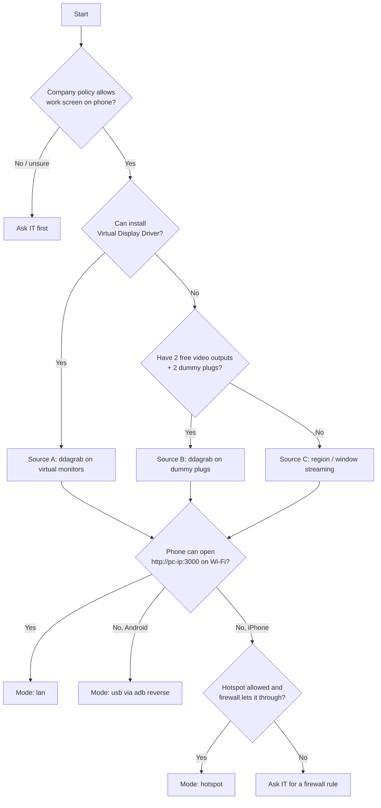

# Phone Monitor — Implementation Plan

Use up to two phones (Android or iOS) as **extended monitors** for a Windows PC.
Phones connect from a browser, so nothing is installed on the phone.

This document is the single source of truth for developers and AI agents. Work through
the tasks in order. Each task lists its inputs, outputs and acceptance criteria. Do not
start a task until all of its dependencies are complete.

---

## 1. Goals and non-goals

### Goals
- G1: Windows shows **2 extra monitors** that it treats as real extended displays.
- G2: Each virtual monitor is streamed to **one phone** over the local network (Wi-Fi), and both streams run at the same time.
- G3: The client works in **Android Chrome** and **iOS Safari (15+)** with no app install.
- G4: Latency is ≤ 150 ms on 5 GHz Wi-Fi at 1080p/30 fps (target).
- G5: Optionally, touch on the phone controls the mouse on the matching monitor.
- G6: Access is limited to the LAN (or a USB cable) and protected by an access token.
- G7: **No-admin path.** The project must be usable on a locked-down work laptop where installing drivers, software or firewall rules is not allowed. See §2.1–§2.4.
- G8: Each step of the setup has a fallback, so the user always knows what to try next (see the decision flow in §2.4).

### Non-goals (v1)
- Audio streaming.
- Access over the internet or NAT traversal, including cloud relays (also a data-leak risk on work machines).
- macOS or Linux hosts.
- Native phone apps.
- Writing a custom display driver. An existing open-source driver is used instead.
- **Bypassing corporate IT controls** (disabling security software, elevating privileges, editing policy). If something is blocked, use a documented fallback or ask IT.

---

## 2. Architecture

```
┌───────────────────────── Windows PC ─────────────────────────┐
│                                                               │
│  Virtual Display Driver (IDD) ──► Monitor A, Monitor B        │
│                                      │          │             │
│                 FFmpeg (ddagrab idx=A)  FFmpeg (ddagrab idx=B)│
│                         │ MJPEG stdout        │ MJPEG stdout  │
│                         ▼                     ▼               │
│  Node server ─ CaptureManager ─ MjpegParser ─ StreamHub       │
│      │  Express (static client)     │                         │
│      │  WebSocket /ws?display=N ◄───┘                         │
│      │  InputController (Win32 SendInput via koffi)           │
└──────┼────────────────────────────────────────────────────────┘
       │  LAN (Wi-Fi 5 GHz)
       ├──► Phone 1 browser  http://<pc-ip>:3000/?display=1&token=…
       └──► Phone 2 browser  http://<pc-ip>:3000/?display=2&token=…
```

### Key decisions

| Topic | Decision | Reason |
|---|---|---|
| Virtual monitors | [Virtual Display Driver](https://github.com/VirtualDrivers/Virtual-Display-Driver) (IDD, signed) | Avoids writing a driver. Supports multiple monitors. |
| Capture | FFmpeg `ddagrab` filter (FFmpeg ≥ 6.0) | Uses the Desktop Duplication API, captures one monitor by index and can use the GPU. |
| Transport (v1) | MJPEG frames as binary WebSocket messages | Works on iOS Safari, unlike MSE/fMP4 on older iPhones. Simple to implement. |
| Transport (v2) | WebRTC (H.264) | Lower bandwidth and latency. Optional later phase. |
| Rendering | `<canvas>` + `createImageBitmap(blob)` | Fast, and works on both platforms. |
| Input | `koffi` FFI → `user32.dll` `SendInput` / `SetCursorPos` | No native compile step. `robotjs` is unmaintained. |
| Display source | Pluggable per display: `ddagrab` (monitor), `gdigrab-region`, `gdigrab-window` | Lets the same server work with a virtual driver, dummy plugs, or no extra monitor at all. |
| Connectivity | Pluggable: `lan` (Wi-Fi) or `usb` (Android `adb reverse`) | Works around blocked firewalls and office Wi-Fi isolation. |
| Tooling install | Portable zips allowed (Node, FFmpeg, adb) | No admin rights needed. |
| Runtime | Node.js 20 LTS+ with ES modules | |
| Language | JavaScript with JSDoc types (`// @ts-check`) | No build step. |

### 2.1 Display sources — how the extra monitors are created

The phones only **display** a picture streamed over the network. Something on the laptop must first give
Windows an extra screen to put windows on. There are three ways, in order of preference:

| Option | What it is | Admin needed? | Extra hardware | Real extended desktop? | `source` value |
|---|---|---|---|---|---|
| **A. Virtual Display Driver** | Software driver that adds fake monitors | **Yes** (driver install) | None | Yes | `ddagrab` |
| **B. HDMI dummy plugs** | Small HDMI stick that pretends to be a monitor; Windows uses its built-in monitor driver | **No** | 1 plug per phone + enough video outputs | Yes | `ddagrab` |
| **C. Region / window streaming** | Stream part of the main screen, or one app window | **No** | None | **No** (mirror only) | `gdigrab-region` / `gdigrab-window` |

#### Option B in detail — HDMI dummy plugs

- A dummy plug (also called "HDMI headless display emulator" or "EDID emulator") plugs into a video output on
  the laptop. Windows detects it as a normal monitor. Nothing is ever shown on the plug itself.
- **The phone never connects to the dummy plug.** The plug only creates the extra screen; the picture reaches
  the phone over Wi-Fi or USB like in every other option.
- **One plug per phone.** For 2 phones you need 2 video outputs, for example:
  - the laptop HDMI port + a USB-C → HDMI adapter (USB-C port must support DisplayPort Alt Mode — look for the
    DP/lightning symbol), or
  - a dock with 2 HDMI/DP outputs.
- Check the laptop's max external displays (spec sheet / Intel Graphics: often 3 total including the built-in screen).
- Buy plugs that advertise **multiple resolutions incl. 1920×1080 and ideally custom/4K EDID**. The resolution you can
  choose in Windows is limited to what the plug's EDID offers, so phone-shaped aspect ratios (19.5:9) are usually not
  available — the client letterboxes the image (black bars).
- Windows treats each plug as a real monitor, so `ddagrab` captures it the same way as a virtual monitor.

```
Laptop
├─ HDMI port   ← dummy plug #1                         → Windows "Monitor 2"
├─ USB-C port  ← USB-C→HDMI adapter + dummy plug #2     → Windows "Monitor 3"
└─ Node server streams Monitor 2 and Monitor 3
        ├── Wi-Fi or USB ──► Phone 1 shows Monitor 2
        └── Wi-Fi or USB ──► Phone 2 shows Monitor 3
```

#### Option C in detail — region / window streaming (last resort)

- **Region:** a rectangle of the main screen (for example the right third) is streamed to a phone. You place
  windows inside that rectangle on the main screen. Uses `gdigrab -offset_x/-offset_y/-video_size`.
- **Window:** one specific app window (by exact title) is streamed. Uses `gdigrab -i title="…"`. The window must
  not be minimized.
- This is **not** an extended desktop — the content is still on the laptop screen. It only frees the user from
  turning the head; it does not add screen space.

### 2.2 Connectivity modes — how the picture reaches the phones

| Mode | How | Works on | Needs | Blocked by |
|---|---|---|---|---|
| **`lan`** (default) | Phone browser → `http://<pc-ip>:3000` over Wi-Fi | Android + iOS | Same network, inbound TCP 3000 allowed | Windows firewall policy, Wi-Fi client isolation, corporate VPN |
| **`usb`** | USB cable + `adb reverse tcp:3000 tcp:3000`; phone opens `http://localhost:3000` | **Android only** | USB debugging enabled on phone, portable `adb` | Corporate policy blocking USB debugging / adb (rare) |
| **`hotspot`** | Laptop joins a phone's hotspot; other phone joins the same hotspot; then same as `lan` | Android + iOS | Policy allows laptop on a hotspot | Windows firewall still applies (hotspot is usually a *Public* network) |

Notes:
- In `usb` mode the connection goes through the adb tunnel to `127.0.0.1`, so **no inbound firewall rule is needed**
  and the server should bind to `127.0.0.1` only (nothing exposed on the network). `localhost` is also a *secure
  context*, so Wake Lock works without HTTPS.
- **iPhone has no equivalent of `adb reverse`.** If the firewall blocks inbound connections, iPhone cannot connect.
  The only options are asking IT for a firewall rule or using a non-work PC. A cloud relay is out of scope (§1).
- A corporate VPN may block access to the local subnet. Test with the VPN disconnected (if policy allows) and
  document the result.
- Two phones can use different modes at the same time (e.g. Android on USB, iPhone on Wi-Fi), as long as the server
  binds to an address both can reach.

### 2.3 Tooling without admin rights

| Tool | Portable source | Notes |
|---|---|---|
| Node.js 20+ | `node-v20.x-win-x64.zip` from nodejs.org | Unzip to e.g. `%USERPROFILE%\tools\node`, add to the user `PATH` (user env vars don't need admin). |
| FFmpeg ≥ 6.0 | "essentials" or "full" build zip (gyan.dev or BtbN) | Set `ffmpegPath` in config to the full path of `ffmpeg.exe`. |
| adb | Android SDK Platform-Tools zip | Only for `usb` mode. Most phones work with the built-in Windows USB driver; some brands need an OEM driver (may need admin). |
| npm packages | `npm install` in the project folder | Installs locally; no admin. `koffi` ships prebuilt binaries (no compiler). |

> ⚠ Before starting, check company policy: streaming a work screen to a **personal phone** may break data-handling
> rules even if it is technically possible. Running unapproved portable software may also be against policy.

### 2.4 Decision flow



---

## 3. Repository layout (target)

```
phone-monitor/
├─ PLAN.md                    ← this file
├─ README.md                  ← setup/usage (Task 7.1)
├─ package.json
├─ config.example.json        ← copied to config.json by user
├─ .gitignore                 ← node_modules, config.json, certs/
├─ scripts/
│  ├─ list-displays.ps1       ← prints monitors with bounds + ddagrab idx
│  ├─ list-windows.ps1        ← prints visible window titles (for gdigrab-window)
│  ├─ check-network.ps1       ← prints LAN IPs, network profile, tests port reachability
│  └─ usb-android.ps1         ← runs adb reverse for every connected Android device
├─ src/
│  ├─ server.js               ← entry point: Express + WebSocket wiring
│  ├─ config.js               ← load/validate config.json
│  ├─ auth.js                 ← token check
│  ├─ displays.js             ← enumerate monitors, map display id → idx/bounds
│  ├─ capture.js              ← CaptureManager: spawn/stop FFmpeg per display
│  ├─ mjpegParser.js          ← split JPEG byte stream into frames
│  ├─ streamHub.js            ← fan-out frames to clients, backpressure
│  ├─ input.js                ← InputController (pointer → Win32)
│  ├─ network.js              ← LAN IP discovery + phone URL printing per mode
│  └─ logger.js
├─ public/
│  ├─ index.html
│  ├─ client.js
│  ├─ styles.css
│  ├─ manifest.webmanifest    ← PWA, for iOS fullscreen via home screen
│  └─ icon-192.png / icon-512.png
└─ test/
   ├─ mjpegParser.test.js
   ├─ config.test.js
   ├─ auth.test.js
   ├─ ffmpegArgs.test.js
   ├─ streamHub.test.js
   ├─ network.test.js
   └─ fixtures/sample.mjpeg
```

---

## 4. Interfaces and contracts

Implementations **must** follow these contracts so tasks can be built in parallel.

### 4.1 `config.json`

```json
{
  "host": "0.0.0.0",
  "port": 3000,
  "mode": "lan",
  "token": "CHANGE-ME-long-random-string",
  "ffmpegPath": "ffmpeg",
  "adbPath": "adb",
  "displays": [
    { "id": 1, "source": "ddagrab", "outputIdx": 1, "fps": 30, "quality": 5, "maxWidth": 1920 },
    { "id": 2, "source": "ddagrab", "outputIdx": 2, "fps": 30, "quality": 5, "maxWidth": 1920 }
  ],
  "input": { "enabled": false },
  "https": { "enabled": false, "keyPath": "certs/key.pem", "certPath": "certs/cert.pem" }
}
```

Fallback examples for the `displays` entries (Option C, §2.1):

```json
{ "id": 1, "source": "gdigrab-region", "bounds": { "x": 1280, "y": 0, "width": 640, "height": 1080 }, "fps": 30, "quality": 5, "maxWidth": 1920 }
{ "id": 2, "source": "gdigrab-window", "windowTitle": "Microsoft Teams", "fps": 15, "quality": 6, "maxWidth": 1280 }
```

- `mode`: `"lan"` | `"usb"` | `"hotspot"` (§2.2). `hotspot` behaves like `lan`; it only changes the startup hints.
  - If `mode` is `"usb"` and `host` is not set explicitly, `host` defaults to `"127.0.0.1"` (not exposed on the network).
- `id`: the public display number used in the URL (`?display=1`).
- `source`: `"ddagrab"` (default; virtual monitor or dummy plug) | `"gdigrab-region"` | `"gdigrab-window"`.
- `outputIdx`: required for `ddagrab`. The FFmpeg `ddagrab` `output_idx`. Find it with `scripts/list-displays.ps1`.
- `bounds`: required for `gdigrab-region`; optional for `ddagrab` (overrides auto-detection for touch input).
  Values are virtual-desktop pixels; `width` and `height` must be even numbers.
- `windowTitle`: required for `gdigrab-window`. Exact window title (see `scripts/list-windows.ps1`).
  Max 200 characters; must not contain `"`, newline or NUL.
- `quality`: FFmpeg MJPEG `-q:v`, from 2 (best) to 31 (worst).
- `fps`: 1–60. `maxWidth`: 320–3840.
- `ffmpegPath` / `adbPath`: command name on `PATH` or full path to a portable `.exe`.
- The server **refuses to start** if `token` is missing, still `CHANGE-ME…`, or shorter than 16 characters.
- The server **refuses to start** if a display is missing the field its `source` requires.

### 4.2 FFmpeg commands (per display, chosen by `source`)

**`ddagrab`** (virtual monitor or dummy plug):
```
ffmpeg -hide_banner -loglevel error
  -f lavfi -i "ddagrab=output_idx=<outputIdx>:framerate=<fps>:draw_mouse=1"
  -vf "hwdownload,format=bgra,scale='min(<maxWidth>,iw)':-2"
  -c:v mjpeg -q:v <quality> -f mjpeg pipe:1
```

**`gdigrab-region`** (part of the main screen):
```
ffmpeg -hide_banner -loglevel error
  -f gdigrab -framerate <fps> -draw_mouse 1
  -offset_x <bounds.x> -offset_y <bounds.y> -video_size <bounds.width>x<bounds.height>
  -i desktop
  -vf "scale='min(<maxWidth>,iw)':-2"
  -c:v mjpeg -q:v <quality> -f mjpeg pipe:1
```

**`gdigrab-window`** (one app window):
```
ffmpeg -hide_banner -loglevel error
  -f gdigrab -framerate <fps> -draw_mouse 1
  -i "title=<windowTitle>"
  -vf "scale='min(<maxWidth>,iw)':-2,pad=ceil(iw/2)*2:ceil(ih/2)*2"
  -c:v mjpeg -q:v <quality> -f mjpeg pipe:1
```

- The quotes above are for readability only. Build the arguments as an **array**; each element is passed
  literally, so no shell quoting is needed (e.g. `['-i', `title=${windowTitle}`]`).
- Spawn with `child_process.spawn(ffmpegPath, args, { shell: false, windowsHide: true })`. Never a shell string.
- stdout carries the MJPEG byte stream, which goes to `MjpegParser`.
- stderr is logged (rate-limited, last 20 lines kept for the `error` message to clients — without file paths).
- If the process exits unexpectedly, restart it with backoff (1 s, 2 s, 4 s … max 30 s).
- `ddagrab` on a laptop with hybrid graphics (Intel + NVIDIA) may fail for monitors attached to the other GPU.
  The error is logged; the fix is documented in troubleshooting (§7.2).
- `gdigrab` is DPI-sensitive: with Windows scaling ≠ 100 %, region offsets are in physical pixels. `list-displays.ps1`
  must report physical pixels (DPI-aware) so the numbers match.

### 4.3 Module APIs

```js
// mjpegParser.js
export class MjpegParser extends EventEmitter {
  push(chunk: Buffer): void          // emits 'frame' (Buffer jpeg) per complete JPEG (FFD8…FFD9)
  reset(): void
}

// capture.js
export function buildFfmpegArgs(display): string[] // pure function, one branch per `source` (§4.2); unit-tested
export class CaptureManager extends EventEmitter {
  constructor(config)
  start(displayId: number): void     // idempotent; emits 'frame' (displayId, Buffer)
  stop(displayId: number): void
  stopAll(): void
  isRunning(displayId: number): boolean
}

// streamHub.js
export class StreamHub {
  constructor(captureManager)
  addClient(displayId: number, ws: WebSocket): void   // starts capture if first client
  removeClient(displayId: number, ws: WebSocket): void // stops capture when last client leaves (after 5 s grace)
}

// displays.js
export async function listDisplays(): Promise<Array<{ index, name, x, y, width, height, primary }>>
export function getBounds(displayId: number): { x, y, width, height }
// For gdigrab-region: returns config bounds. For gdigrab-window: resolved at input time from the window rect
// (input.js calls GetWindowRect via koffi). For ddagrab: config bounds override, else auto-detected.

// network.js
export function lanAddresses(): Array<{ iface: string, address: string }> // IPv4, non-internal, from os.networkInterfaces()
export function phoneUrls(config): Array<{ display: number, url: string }>  // per mode: lan/hotspot → LAN IPs, usb → localhost

// input.js
export class InputController {
  constructor(config, displays)
  pointer(displayId: number, action: 'down'|'move'|'up', nx: number, ny: number): void // nx, ny in [0,1]
}

// auth.js
export function isValidToken(provided: string | null, expected: string): boolean // timing-safe
```

### 4.4 WebSocket protocol

**Endpoint:** `GET /ws?display=<id>&token=<token>` (upgrade)

- Invalid token: respond with HTTP 401 during the upgrade, before the WebSocket is created.
- Unknown display: close the socket with code `4004` and reason `"unknown display"`.

**Server → client**

| Kind | Payload |
|---|---|
| text | `{"type":"hello","display":1,"fps":30,"inputEnabled":false}` |
| binary | One complete JPEG frame |
| text | `{"type":"error","message":"capture failed, retrying"}` |

**Client → server** (text JSON; ignored if input is disabled)

| Payload | Meaning |
|---|---|
| `{"type":"pointer","action":"down","x":0.5,"y":0.25}` | x and y are normalized to [0,1] relative to the frame |
| `{"type":"ping","t":<ms>}` | Server replies `{"type":"pong","t":<ms>}`. Used for latency display. |

The server validates every message with a schema check: known type, numbers within range, size ≤ 1 KB. Invalid messages are dropped.

### 4.5 Backpressure rule
Before sending a frame to a client, the server checks `ws.bufferedAmount`. If it is above **2 MB**, the server **drops this frame** for that client and does not queue it. Only the newest frame matters.

---

## 5. Tasks

Status legend: `[ ]` todo, `[~]` in progress, `[x]` done. Update the checkbox when a task is done.

### Phase 0 — Environment (manual, done by the user)

Follow the decision flow in §2.4. Do **one** of 0.2A / 0.2B / 0.2C, and **one** of 0.5A / 0.5B / 0.5C.

- [ ] **0.1 Policy check**
- [ ] **0.2A Virtual Display Driver (needs admin)**
- [ ] **0.2B HDMI dummy plugs (no admin)**
- [ ] **0.2C No extra screens (fallback)**
- [ ] **0.3 FFmpeg ≥ 6.0**
- [ ] **0.4 Node.js 20 LTS+**
- [ ] **0.5A `lan` mode — Wi-Fi**
- [ ] **0.5B `usb` mode — Android only**
- [ ] **0.5C `hotspot` mode — iPhone when office Wi-Fi blocks phone-to-laptop traffic**

(Phase 0 is manual host/hardware setup — see git history of this file for the full step text.)

### Phase 1 — Project skeleton

- [x] **1.1 Initialize the package** — `package.json` (`type: module`, `engines.node >= 20`, `start`/`test` scripts, deps express/ws/koffi), `.gitignore`, `config.example.json`.
- [x] **1.2 `logger.js`** — leveled logger (`info`/`warn`/`error`/`debug`) with timestamps, `LOG_LEVEL` from env.
- [x] **1.3 `config.js`** — load+validate config.json (types/ranges/unique id+outputIdx, token rule, per-source required fields, mode values, windowTitle char rules, even bounds, usb host default). `test/config.test.js`.
- [x] **1.4 `auth.js`** — `crypto.timingSafeEqual`, length-mismatch safe. `test/auth.test.js`.

### Phase 2 — Capture pipeline (deps: 1.x)

- [x] **2.1 `scripts/list-displays.ps1`** — DPI-aware monitor list via `Screen.AllScreens`, `-Json` switch, ddagrab index test hint.
- [x] **2.2 `mjpegParser.js`** — streaming SOI/EOI parser, split markers, 20 MB overflow reset. `test/mjpegParser.test.js`.
- [x] **2.3 `capture.js`** — `buildFfmpegArgs` (all three sources) + `CaptureManager` (array spawn, backoff restart, kill on stop/exit, `window not found` for gdigrab-window). `test/ffmpegArgs.test.js`.
- [x] **2.4 `displays.js`** — parse `list-displays.ps1 -Json`, map id → bounds (config override else auto-detect).
- [x] **2.5 `scripts/list-windows.ps1`** — visible titled windows for `windowTitle`.
- [x] **2.6 `scripts/check-network.ps1` + `src/network.js`** — IPs/profile/VPN/phone URLs + local healthz probe; `lanAddresses()`/`phoneUrls()`, virtual-adapter filtering. `test/network.test.js`.

### Phase 3 — Server and streaming (deps: 2.2, 2.3)

- [x] **3.1 `streamHub.js`** — fan-out, first-client-start / last-client-stop (5 s grace), 2 MB backpressure drop. `test/streamHub.test.js`.
- [x] **3.2 `server.js`** — Express static (`no-store` HTML, `nosniff`, CSP), `ws` noServer with token check on upgrade (401), `hello` + §4.4 messages, 15 s heartbeat, optional HTTPS, `/healthz`, startup URL print + hints, graceful SIGINT.

### Phase 4 — Phone client (deps: 3.2)

- [x] **4.1 `index.html` + `styles.css`** — full-viewport canvas, tap-to-start overlay, status pill, meta tags, manifest link.
- [x] **4.2 `client.js`** — read query, WS blob stream, `createImageBitmap` (+Image fallback), rAF latest-frame draw, letterbox+DPR+orientation, reconnect backoff, fullscreen/iOS hint, Wake Lock, 2 s ping RTT.
- [x] **4.3 PWA assets** — `manifest.webmanifest`, `icon-192/512.png`, `apple-touch-icon`.

### Phase 5 — Touch input (optional; deps: 2.4, 3.2)

- [x] **5.1 `input.js`** — koffi → user32 `SetCursorPos`/`SendInput`, normalized→pixel mapping via `getBounds`, `FindWindowW`+`GetWindowRect` for gdigrab-window, `SetProcessDpiAwarenessContext(-4)`.
- [x] **5.2 Client pointer events** — Pointer Events on canvas, normalized to letterbox rect (ignore bars), move throttled per rAF, `touch-action: none`.
- [x] **5.3 Server wiring** — only when `input.enabled`; rate-limited to ≤ 120 msg/s per socket.

### Phase 5A — Connectivity modes (deps: 3.2)

- [x] **5A.1 `scripts/usb-android.ps1`** — `-Port`/`-AdbPath`/`-Remove`, parse `adb devices`, warn unauthorized/offline, array-arg adb calls.
- [x] **5A.2 Optional auto-reverse in server (`mode: "usb"`)** — poll `adb devices` every 5 s, reverse new serials, warn-once if adb missing.
- [x] **5A.3 Bind address and mixed modes** — usb→127.0.0.1, lan/hotspot→0.0.0.0; mixed (Android USB + iPhone Wi-Fi) works via `adb reverse` to localhost.
- [x] **5A.4 Client connection hints** — help panel after 3 consecutive WS failures, no server details.

### Phase 6 — Hardening and performance

- [x] **6.1** Per-display `fps`/`quality`/`maxWidth` honored (via `buildFfmpegArgs`); presets documented in README §8 (Battery 15/q8, Balanced 30/q5, Sharp 30/q3).
- [x] **6.2** Limit concurrent clients to 4 per display; extra connections closed with code `4029`.
- [x] **6.3** `tokenFingerprint()` added and logged at startup; no code path logs the full token (except the startup phone URLs the user needs verbatim, per §3.2).
- [~] **6.4** Soak-test procedure documented in README §9 (RSS sampling, no-zombie check). Not yet executed — needs 2 phones for 30 min.
- [~] **6.5** Latency-measurement procedure documented in README §9 (live pill RTT + ms-clock photo). Not yet recorded — needs hardware.

### Phase 7 — Docs and release

- [x] **7.1** `README.md` — policy check, decision flow, all Phase 0 screen/connectivity options, portable tool setup, config examples per `source`/`mode`, run commands, phone URLs, iOS Home Screen tip, presets, perf/soak procedure. (Windows Display-settings screenshots are the one remaining nice-to-have.)
- [x] **7.2** Troubleshooting table (symptom → cause → fix) in README §12.

### Phase 8 — Future (not in v1)

- WebRTC H.264 transport (`ddagrab` + `h264_nvenc`/`qsv`/`amf`, e.g. `werift`).
- Keyboard input from the phone.
- iPhone over USB (needs a native app or third-party tunnel; out of scope for a browser-only client).
- A tray app / service wrapper to start the server with Windows.

---

## 6. Conventions for contributors and AI agents

- **One task per change.** Reference the task ID in commit messages, e.g. `feat(capture): 2.3 CaptureManager with restart backoff`.
- Stay inside the contracts in §4. If a contract has to change, update this file **in the same change**.
- Use ES modules, `// @ts-check` with JSDoc at the top of each source file, and no TypeScript build.
- Use no external dependencies beyond `express`, `ws` and `koffi` without updating §2.
- Never build shell command strings. Always use `spawn(cmd, argsArray)` (FFmpeg and adb alike). In PowerShell, use `& $exe @argsArray`.
- No step may require or attempt privilege elevation. Anything needing admin rights must be an optional, documented path (§2.1–§2.3).
- Validate all client input. Treat the network as untrusted even on a LAN.
- Tests use `node:test` and `node:assert/strict`, and must not need FFmpeg or a GPU. Mock `child_process` when testing capture.
- Windows-only APIs (koffi/user32) must be imported **lazily** so tests can run on any OS.

### Definition of done (every task)
1. The acceptance criteria are met.
2. `npm test` passes.
3. There are no new errors when the server starts.
4. The task checkbox in this file is updated.

---

## 7. Risks and mitigations

See the key risks table: `ddagrab` index order, iOS Safari limits, MJPEG bandwidth, aspect/letterboxing, DPI input
mapping, LAN-exposed mouse control, admin-blocked driver install, dummy-plug EDID limits, firewall/Wi-Fi isolation/VPN
blocking inbound, and work-data-on-personal-phone compliance. Each is mitigated by the pluggable `source`/`mode`
design, the token + input-off-by-default security posture, and the Phase 0.1 policy check.
